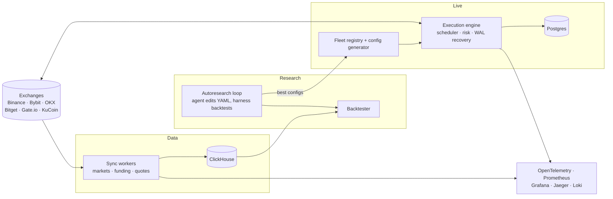

# crypto-market-data-platform

[](https://github.com/nicolasMazuryk/crypto-market-data-platform/actions/workflows/ci.yml)
[](LICENSE)

TypeScript platform that ingests market and funding data from six exchanges into ClickHouse, backtests and auto-tunes strategies, and runs a live execution fleet. Infrastructure is Terraform/Ansible-provisioned and observed with OpenTelemetry, Prometheus and Grafana.

## The problem

Funding-rate strategies on perpetual futures only work if you can replay them against complete, trustworthy order-book and funding history, and then run the same logic live with strict risk limits. This repo is the whole loop: collect the data, prove a strategy on it, tune its parameters, and deploy it to sub-accounts on Binance, Bybit, OKX, Bitget, Gate.io and KuCoin.

## Architecture



## Stack

TypeScript (ESM, `tsx`), Node 22, ClickHouse, PostgreSQL with Drizzle ORM, Vitest, ESLint and Prettier, Docker Compose, Terraform (Hetzner), Ansible, OpenTelemetry, Prometheus, Grafana, Jaeger, Loki.

## Getting started

```bash
npm ci
cp .env.example .env     # fill in credentials; dry-run needs no exchange keys
npm run lint
npm run typecheck
npm run build
npm run test:ci          # everything except the ClickHouse-backed src/db tests
```

`npm test` also runs the `src/db` integration tests, which need a local ClickHouse (`npm run db:up`).

Common entry points:

```bash
npm run sync:markets        # exchange market metadata
npm run sync:funding        # funding-rate history
npm run backtest            # run a strategy backtest
npm run execution:dry-run   # execution engine against live data, no orders
npm run autoresearch:list   # show configured tuning runs
```

## Project structure

```
src/
  sync/ markets/ quotes/ db/   data ingestion and ClickHouse access
  backtesting/                 deterministic backtest engine and reporting
  autoresearch/                agent-driven parameter tuning harness
  execution/                   live engine: strategies, risk, WAL recovery, fleet, provisioning
config/  live-configs/         engine and per-exchange strategy YAML
ansible/ terraform/ docker/    provisioning, infrastructure and the observability stack
```

## Configuration and secrets

All credentials are read from the environment (`.env` locally via dotenv, the controller environment for Ansible). `.env.example` lists every variable. `.env*`, Terraform state and `live-configs/registry.yaml` are gitignored; copy `live-configs/registry.example.yaml` to create your own registry.

## Design decisions

- **One execution engine, many exchanges.** Strategies are exchange-agnostic; per-exchange differences live in YAML (`live-configs/strategies/`), not engine constants.
- **Crash-safe state.** Orders and positions are recovered from a write-ahead log and Postgres, so a restart resumes in-flight trades.
- **Research is automated but gated.** The autoresearch agent may only edit a strategy's YAML; a diff gate reverts anything else and every change must beat the backtest baseline.
- **Everything is reproducible infrastructure.** Terraform creates the host, Ansible deploys the Compose stack and systemd timers.

More detail: [execution engine docs](src/execution/docs/README.md), [AUTORESEARCH.md](AUTORESEARCH.md), [RUNBOOK.md](RUNBOOK.md).

## Roadmap and limitations

- CI runs lint, formatting, typecheck, build and the unit tests. The `src/db` integration tests need ClickHouse and are not in CI yet.
- Historical order-book datasets are not included; you need your own exchange downloads.
- The registry stores credentials in a local, gitignored file written by the provisioning CLI; a secrets-manager backend is not implemented.
- `TODO(me): screenshot` of the Grafana execution dashboard.

## License

[MIT](LICENSE)
