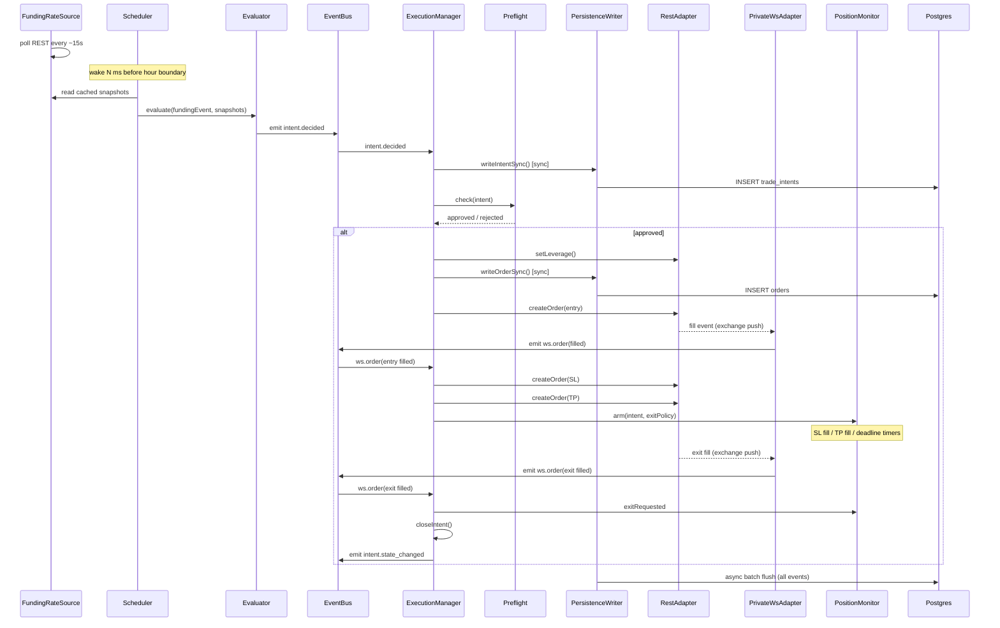

# Execution Engine — Architecture

## Components

| Component | Path | Role |
|-----------|------|------|
| **Entrypoint** | [`src/execution/index.ts`](../index.ts) | `startEngine()` wires every subsystem in dependency order and returns an `EngineHandle`. `main()` parses CLI args (`--config`, `--mode`, `--exchange`, etc.) and handles `SIGINT`/`SIGTERM` for graceful shutdown. |
| **Event bus** | [`src/execution/core/bus.ts`](../core/bus.ts) | Typed in-process event bus (thin `EventEmitter` wrapper). All cross-component communication flows through named domain events — no direct coupling between publisher and subscriber. |
| **Clock** | [`src/execution/core/clock.ts`](../core/clock.ts) | Wraps `Date.now()` and `performance.now()`. Records per-exchange server/local time delta; emits a `clock.skewBreach` event when delta exceeds 300 ms; skew is used to adjust exit timer deadlines. |
| **ID deriver** | [`src/execution/core/ids.ts`](../core/ids.ts) | `newIntentId()` generates UUID v4. `intentId()` derives a deterministic hash from `strategy\|exchange\|symbol\|nextFundingTimestamp` for deduplication. `forIntent()` / `forExit()` derive client order IDs (≤ 28 chars for exchange compatibility). |
| **Logger** | [`src/execution/core/logger.ts`](../core/logger.ts) | Pino extension with `childFor(component, extra)` and `childForIntent(intent)` helpers for consistent structured context. |
| **Rate limiter** | [`src/execution/core/ratelimit/tokenBucket.ts`](../core/ratelimit/tokenBucket.ts) | Token-bucket per-exchange rate limiter, shared across REST adapter calls. |
| **Funding rate source** | [`src/execution/funding/source.ts`](../funding/source.ts) | Polls each exchange's REST funding-rate endpoint every ~15 s; caches results as `Map<exchange, Map<symbol, FundingSnapshot>>`; marks snapshots stale after 2× pull interval; emits `funding.snapshot` events when values change. Exchange-specific pullers in `src/execution/funding/{binance,bybit,okx,bitget,gateio,kucoin}.ts`. |
| **Funding event scheduler** | [`src/execution/execution/scheduler.ts`](../execution/scheduler.ts) | Wakes N ms before each hourly funding window boundary; filters eligible symbols by window and staleness; calls `StrategyEvaluator`; pre-warms leverage per symbol via single-flight deduplication. Supports a fixed-time override for testing. Catches up if the engine starts mid-window. |
| **Strategy evaluator** | [`src/execution/strategies/evaluator.ts`](../strategies/evaluator.ts) | Receives a funding event and cached snapshots; evaluates all registered strategy rules; deduplicates intents by `(strategy, exchange, symbol, nextFundingTimestamp)`; emits `intent.decided` on the bus. |
| **Strategy registry** | [`src/execution/strategies/registry.ts`](../strategies/registry.ts) | Map-based registry — single source of truth for which strategies are active. Only `strategy_1` and `strategy_3a` are registered in the live engine. |
| **Execution manager** | [`src/execution/execution/manager.ts`](../execution/manager.ts) | Central intent state machine. Subscribes to `intent.decided` on the bus; runs `writeIntentSync` → preflight → leverage set → `writeOrderSync` → `createOrder(entry)`. After entry fill: places SL + TP exit orders, arms the position monitor. On exit fill or timer: cancels the opposing exit order and closes the intent. Handles WS events, REST polling fallback (Bitget, KuCoin), partial fills, orphaned reduce-only order sweeps, smart risk preemption (cancel worst intent if a cap would be breached), and full `flattenAll()` on shutdown. |
| **Preflight** | [`src/execution/execution/preflight.ts`](../execution/preflight.ts) | Validates each intent before any REST call: market existence, leverage cap, order quantity (lot-size rounding), min-notional check, balance sufficiency (margin calculation), global and per-strategy concurrent-intent caps, global and per-strategy notional caps, kill-switch state. Returns a typed error code on rejection. |
| **Position monitor** | [`src/execution/execution/monitor.ts`](../execution/monitor.ts) | Arms exit timers after entry fill: simple delay for timed exits, or a parallel set of SL fill / TP fill / deadline timers for bracket exits. Uses clock skew to adjust deadlines. Emits `exitRequested` when any condition fires. |
| **Kill switch** | [`src/execution/risk/killSwitch.ts`](../risk/killSwitch.ts) | Three-state machine: `live` → `dry_run` → `halted`. `trip(reason)` transitions to `halted` and calls `flattenAll()` (wired to the execution manager to break the dependency cycle). `canPlaceOrder()` returns `false` in `halted` mode, blocking all new order submissions. |
| **State store** | [`src/execution/state/store.ts`](../state/store.ts) | In-memory cache for orders, positions, and balances per exchange. Tracks WS sequence numbers for gap detection. Emits `state.desync` events (`unknown_order`, `order_status_mismatch`, `position_qty_mismatch`, `balance_mismatch`, `sequence_gap`) to trigger reconciliation. |
| **Reconciler** | [`src/execution/state/reconcile.ts`](../state/reconcile.ts) | Periodically fetches open orders, positions, and balances from REST; diffs against local state; emits synthetic events to bring the state store in sync; records timing metrics. |
| **REST adapters** | [`src/execution/adapters/rest/{binance,bybit,okx,bitget,gateio,kucoin}.ts`](../adapters/rest/) | Per-exchange REST clients implementing a common interface: `createOrder`, `cancelOrder`, `amendOrder`, `getOpenOrders`, `getBalance`, `getPositions`, `getServerTime`, `setLeverage`, `fetchFundingRate`. |
| **Shadow REST adapter** | [`src/execution/adapters/rest/shadow.ts`](../adapters/rest/shadow.ts) | Dry-run stub. Simulates fills after `fillDelayMs` (default 150 ms) and emits `ws.order` events. Returns a synthetic USDT balance (default 100,000). `getPositions()` returns empty. |
| **REST adapter factory** | [`src/execution/adapters/rest/factory.ts`](../adapters/rest/factory.ts) | Routes to the appropriate exchange adapter or the shadow adapter based on engine mode. |
| **Private WS adapters** | [`src/execution/adapters/privatews/{binance,bybit,okx,bitget,gateio,kucoin}.ts`](../adapters/privatews/) | Per-exchange authenticated WebSocket clients. Stream `order`, `position`, `balance`, and `fundingFee` events. Manage reconnect logic with exponential backoff. |
| **Shadow WS adapter** | [`src/execution/adapters/privatews/shadow.ts`](../adapters/privatews/shadow.ts) | No-op WebSocket for dry-run mode; creates the typed event emitter interface without connecting. |
| **Persistence writer** | [`src/execution/persistence/writer.ts`](../persistence/writer.ts) | Async queue-based writer: 100-row batches, 250 ms flush. Subscribes to bus events (`intent.decided`, `intent.state_changed`, `order.placed`, `ws.order`, `ws.position`, `ws.balance`, `ws.funding_fee`, `state.desync`, `ops.event`) and fans out to the correct Postgres table. Permanent errors (bad schema, constraint violations) bypass the WAL. `writeIntentSync()` and `writeOrderSync()` provide synchronous durability before each REST call. |
| **WAL** | [`src/execution/persistence/wal.ts`](../persistence/wal.ts) | JSON line-delimited file on disk. `append` / `peek` / `rewrite` for atomic replay. 50 MB cap. Consumed by the recovery process on startup. |
| **Database** | [`src/execution/persistence/db.ts`](../persistence/db.ts) | Postgres connection via Drizzle ORM; 5-connection pool; `openDb()` factory. |
| **Recovery** | [`src/execution/recovery/index.ts`](../recovery/index.ts) | On startup: resumes the most recent open run or creates a new one; rehydrates active intents from the `trade_intents` table (reconstructing fill state, exit policy, and order ID maps); fetches open orders and positions from REST to cancel or flatten orphans not in the rehydrated set. |
| **Metrics** | [`src/execution/observability/metrics.ts`](../observability/metrics.ts) | In-process Prometheus registry with counters, gauges, and histograms. Exposes `GET /metrics` in Prometheus text format on the same HTTP server as the health endpoints. |
| **Health server** | [`src/execution/observability/health.ts`](../observability/health.ts) | HTTP server on `:9466`. `GET /health` always returns 200. `GET /ready` returns 200 when `setReady(true)` has been called, 503 otherwise. |
| **Alert dispatcher** | [`src/execution/observability/alerts.ts`](../observability/alerts.ts) | Slack webhook dispatcher. `page` severity prefixes with `<!channel>`. Subscribes to WS disconnect events (pages after 30 s of sustained disconnect) and to `ops.event` bus events (pages on `fatal`/`error`, notifies on `warn`). No-op when `SLACK_WEBHOOK_URL` is absent. |
| **Tracer** | [`src/execution/observability/tracing.ts`](../observability/tracing.ts) | OpenTelemetry OTLP exporter (targeting Jaeger). Falls back to a no-op tracer when tracing is disabled in config. Supports `always_on`, `parent`, and `ratio` sampler modes. |
| **Market metadata** | [`src/execution/markets/`](../markets/) | CCXT-backed provider for lot sizes, tick sizes, min-notional, and exchange symbol maps. Used by preflight for quantity rounding and cost validation. |
| **Config loader** | [`src/execution/config/loader.ts`](../config/loader.ts) | Loads `execution.base.yaml` then the mode-specific YAML (`dry-run` or `live`); deep-merges in precedence order (schema defaults → base → mode → env vars → CLI flags); injects API credentials from env; hashes the merged config for run versioning. See [configuration.md](./configuration.md) for full reference *(Step 3)*. |

---

## Data flow — funding-event lifecycle

```
FundingRateSource
  └─ polls exchange REST every ~15 s per exchange
  └─ caches Map<exchange, Map<symbol, FundingSnapshot>>
  └─ marks snapshot stale after 2× pull interval
  └─ emits funding.snapshot on change

FundingEventScheduler  (wakes N ms before each hourly window)
  └─ reads cached funding snapshots from FundingRateSource
  └─ filters symbols: active, within window, not stale
  └─ pre-warms leverage per symbol (single-flight dedup)
  └─ calls StrategyEvaluator.evaluate(fundingEvent, snapshots)

StrategyEvaluator
  └─ applies strategy_1 / strategy_3a rules
  └─ deduplicates by (strategy, exchange, symbol, nextFundingTimestamp)
  └─ emits intent.decided → EventBus

ExecutionManager  (subscribed to intent.decided)
  └─ PersistenceWriter.writeIntentSync()     ← sync INSERT trade_intents (FK anchor)
  └─ Preflight.check(intent)                 ← caps, balance, kill-switch; reject fast
  └─ RestAdapter.setLeverage()               ← single-flight per (exchange, symbol)
  └─ PersistenceWriter.writeOrderSync()      ← sync INSERT orders (durable before REST)
  └─ RestAdapter.createOrder(entry)

Exchange fills entry order
  └─ PrivateWsAdapter receives fill event, emits ws.order(filled) → EventBus

ExecutionManager  (subscribed to ws.order, entry fill branch)
  └─ RestAdapter.createOrder(SL)             ← stop_market at [0]
  └─ RestAdapter.createOrder(TP)             ← limit at [1]
  └─ PositionMonitor.arm(intent, exitPolicy)

PositionMonitor
  └─ starts SL fill / TP fill / deadline timers in parallel
  └─ emits exitRequested when the first timer or fill event fires

ExecutionManager  (on exitRequested)
  └─ cancels the opposing exit order (SL if TP filled, TP if SL fired)
  └─ marks intent state → closed
  └─ emits intent.state_changed → EventBus

Throughout
  └─ PersistenceWriter: async 250 ms batches → Postgres
      tables: trade_intents, orders, orders_status, positions_history,
              balances_history, funding_attributions, ops_events, runs
  └─ WAL: file-based fallback for transient Postgres failures;
          replayed into DB on next startup via Recovery
  └─ StateStore + Reconciler: keep in-memory order/position/balance
      state consistent with exchange REST; emit state.desync on mismatch
  └─ KillSwitch: blocks new orders in halted mode;
                 flattenAll() cancels all open orders and market-closes positions
  └─ Recovery: on restart, rehydrates active intents from DB,
               cancels/flattens orphaned exchange orders and positions
```

---

## Sequence diagram — funding event to position close



---

## Startup sequence

`startEngine()` in [`src/execution/index.ts`](../index.ts) initializes components in this order:

1. Load and validate config (`loadEngineConfig`)
2. Create event bus, clock, ID deriver, logger
3. Init tracing (OTel or noop)
4. Create metrics registry; register base metrics; start health + metrics HTTP server
5. Create REST adapters (one per configured exchange) with rate limiters
6. Open Postgres connection; replay WAL into DB
7. Run `Recovery` — resume or create run record, rehydrate intents, flush orphans
8. Create `StateStore`
9. Create private WS adapters; connect
10. Create `PositionMonitor`
11. Create `KillSwitch`; wire `flattenAll` to `ExecutionManager`
12. Create `ExecutionManager`
13. Create `FundingRateSource`; start polling
14. Create `MarketMetadataProvider` (if enabled)
15. Register strategies in `StrategyRegistry`
16. Create `StrategyEvaluator`
17. Create `FundingEventScheduler`; start
18. Subscribe `PersistenceWriter` to bus events
19. Subscribe `AlertDispatcher` to bus events
20. Mark health server `ready = true`
21. Return `EngineHandle`

---

## External dependencies

| System | Protocol | Role |
|--------|----------|------|
| Binance (binanceusdm) | REST + authenticated WebSocket | Orders, fills, positions, balances, funding rates |
| Bybit | REST + authenticated WebSocket | Orders, fills, positions, balances, funding rates |
| OKX | REST + authenticated WebSocket | Orders, fills, positions, balances, funding rates |
| Bitget | REST + authenticated WebSocket + REST polling fallback | Orders, fills, positions, balances, funding rates |
| Gate.io | REST + authenticated WebSocket | Orders, fills, positions, balances, funding rates |
| KuCoin Futures | REST + authenticated WebSocket + REST polling fallback | Orders, fills, positions, balances, funding rates |
| Postgres | TCP (Drizzle ORM, 5-conn pool) | Durable storage for intents, orders, positions, balances, attributions, run records |
| Prometheus | HTTP pull on `:9466/metrics` | Metrics scraping |
| Grafana | HTTP | Dashboard rendering (dashboards in `src/execution/observability/grafana/`) |
| Loki / Promtail | HTTP push | Log aggregation from stdout |
| Jaeger | OTLP HTTP | Distributed tracing |
| Alertmanager | HTTP webhook | Alert routing to Slack |
| Slack | HTTPS webhook | Incident notifications (direct from `AlertDispatcher` + via Alertmanager) |

---

## Trading logic

For what each strategy *does* — entry triggers, position direction, sizing rules, exit conditions, and parameter tables — see [trading-logic.md](./trading-logic.md) *(Step 2)*.
